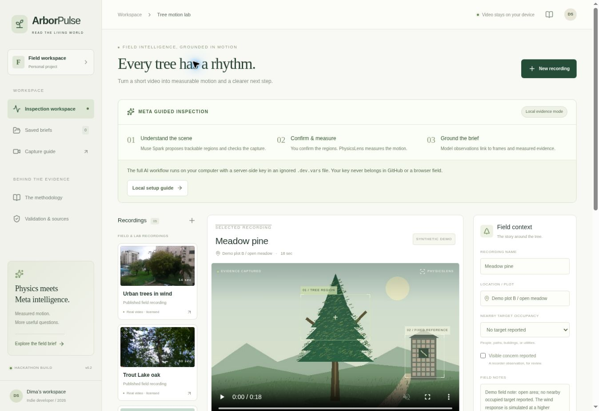

# ArborPulse

[Demo video (2:59)](https://youtu.be/_rO7AkyZbiE) · [Repository](https://github.com/Finraell/ArborPulse) · [Local setup](docs/deployment.md)

**Every tree has a rhythm. Turn video into traceable inspection evidence.**

Meta Global AI Developer Hackathon 2026 · Indie developer · Push the Frontier.
The source repository is public. The hosted workspace remains owner-private and
unkeyed; the complete app runs locally using the setup below.

ArborPulse combines local motion measurement with **Muse Spark 1.3** at two useful
points: planning what to measure, and interpreting the evidence afterward. It
helps a qualified arborist prepare questions and review a capture. It does not
predict failure, diagnose hidden decay, or certify a tree as safe.



## Run the complete app locally

Requires Node.js **22.13+**, Git, and pnpm **11.25.0**.

```bash
git clone https://github.com/Finraell/ArborPulse.git
cd ArborPulse
corepack enable
corepack prepare pnpm@11.25.0 --activate
pnpm install --frozen-lockfile
pnpm setup:local
```

Open the newly created **`.dev.vars`** in your editor and set:

```dotenv
MODEL_API_KEY="your-key-entered-only-on-your-computer"
META_MODEL="muse-spark-1.3"
META_MAX_REQUESTS_PER_HOUR="20"
```

```bash
pnpm local:doctor
pnpm meta:check
pnpm local
```

Open **http://localhost:5173**. Windows users may also launch
`Start-ArborPulse.ps1` after installation. `local:doctor` prints configuration
status without printing the key. `meta:check` makes one small, real model call
and prints its response ID and usage. No key is needed for video measurement,
charts, deterministic briefs, or exports.

`.dev.vars` is ignored by Git. The local server holds the credential and binds
to loopback. Do not put the key in a browser field, frontend environment variable,
GitHub issue, screenshot, commit, or source archive. CI runs a credential scan.

## The inspection workflow

1. Select a licensed real recording, a labelled controlled fixture, or a local
   MP4/MOV/WebM file (up to 250 MB; browser codec support varies).
2. With your consent, **Inspect scene with Muse Spark** sends six timestamped
   JPEG stills and notes to Meta. The model proposes a textured tree region and a
   separate world-stationary reference, with frame-linked capture checks.
3. Review both boxes and confirm them, or keep manual regions. AI proposals
   remain provisional. An overlay or moving tree cannot serve as a fixed reference.
4. **Run motion scan** decodes locally at 12 Hz, at most 640 px wide, over the
   first 60 seconds. It tracks features, subtracts reference translation, and
   measures projected displacement and a gated observed response frequency.
5. Inspect the trace, spectrum, quality warnings, and six source frames. Poor
   capture quality produces **Recapture**. Context-based queue priority uses
   recorder concerns and target occupancy; sway amplitude is not a risk score.
6. Generate the **grounded AI brief**. Each finding cites a supplied frame,
   measurement, or field-note ID. The server rejects unknown/mistyped references.
7. Export CSV, a full evidence JSON, a standalone illustrated HTML report, or a
   text brief. The HTML opens offline and can be printed to PDF. It preserves
   source attribution and contains no scripts, API key, or remote image loads.

The browser keeps the full video local. The server receives sampled stills only
on an explicit AI action. Saved text briefs use localStorage; uploaded videos and
unsaved measurements are session-local. Offline reload is not guaranteed.

## What Meta actually does

| Stage | Model input | Concrete output | Verification |
| --- | --- | --- | --- |
| Scene planning | Six labelled frames, notes | Two proposed regions, reasons, capture concerns | Bounded non-overlapping boxes; known frame IDs; human confirmation |
| Grounded interpretation | Measured metric IDs, six frames, recorder evidence | Source-linked observations, on-site questions, capture advice | Strict JSON schema; source-type and reference checks |
| Response provenance | Provider metadata | Model, request ID, time, prompt version, token use, cost estimate | Produced only after a successful validated API response |

The adapter uses `https://api.meta.ai/v1/chat/completions`, multimodal
`image_url` input, and strict JSON-schema output. Identical requests are deduped
in flight and cached for 30 minutes; rejected responses are never cached. There
are no automatic paid retries. The default cap is 20 requests/hour **per process**,
not a durable public-service quota. Receipts show estimated standard-mode cost;
the provider dashboard remains authoritative for billing and credit balance.

**Local operator testing has verified live Meta Model API responses.** Scene
planning and grounded briefs were exercised with licensed Urban footage and the
labelled synthetic Meadow pine control. Response receipts retain the model,
request ID, token usage and prompt version. Automated provider contract tests use
labelled fixtures; they are not presented as live model responses. Health status
distinguishes a configured key from a verified response. API credentials remain
local and are not included in the repository. SAM segmentation and voice are not
implemented or claimed.

## Real footage and reproducible verification

Two licensed real recordings accompany three synthetic known-input fixtures.
The real clips intentionally expose camera/reference limitations. They do not
supply tree-health labels. A useful tool must be able to decline a measurement.

| Check | Reference | Current expected behavior |
| --- | --- | --- |
| Synthetic oak | Imposed 0.35 Hz | Recover within one spectral bin |
| Synthetic pine | Imposed 0.75 Hz | Recover within one spectral bin |
| Deliberate camera shake | Known capture fault | Recapture; suppress frequency |
| Urban trees in wind | Real footage, no motion truth | Preset camera-motion gate requests recapture |
| Trout Lake oak | Research clip, camera on adjacent tree | Known reference limitation forces recapture |

Measured OpenCV results are in [the validation manifest](public/validation/report.json)
and raw evidence in [docs/data](docs/data). Browser evidence exports are recorded
separately because the tracking implementations differ. Published Trout Lake
optical values (0.23–0.24 Hz), the matching-window accelerometer value (0.49 Hz),
and the 30-minute sensor value (0.24 Hz) must not be conflated.

```bash
pnpm security:check
pnpm typecheck
pnpm test
pnpm build
```

Optional Python checks and full-video benchmark:

```bash
python -m venv .venv
# Activate it: macOS/Linux: source .venv/bin/activate
# Windows PowerShell: .venv\Scripts\Activate.ps1
pip install -r backend/requirements-dev.txt
PYTHONPATH=backend pytest backend/tests -q
PYTHONPATH=backend python scripts/validate_recordings.py
```

The TypeScript suite covers signal gates, evidence consistency, consent, body
limits, origin checks, model provenance, rejected-result recovery, paid-call
deduplication, and safe report export. Python tests also decode the actual videos.
Windows users can set `$env:PYTHONPATH="backend"` before the Python commands.
Recreate controlled videos with `python scripts/generate_demo.py` (Pillow and
ffmpeg required). Real video source metadata and derivative changes are retained.

## Hosting and the $150 credits

Start locally while developing. API credits belong to the provider account/team
behind your key; local versus hosted execution does not change that. Confirm the
credits are eligible for **Meta Model API** in the project you select. A credit
issued by another inference provider requires that provider's integration.

For a judging URL, deploy this app with `MODEL_API_KEY` stored as a **server-side
hosting secret**. It does not go in the repository or GitHub Actions. The current
hosted workspace remains owner-private and unkeyed. Before public multi-user
access, add durable authentication and per-user spending limits. Publishing the
source repository and opening the hosted app to judges are separate steps.

## Architecture and boundaries

React/TypeScript on Vite + Vinext, packaged as a Cloudflare Worker by Sites. No
database or cloud video store is required. The optional FastAPI/OpenCV service
provides a second reproducible motion engine; the frontend does not call it.

```bash
pip install -r backend/requirements.txt
PYTHONPATH=backend uvicorn arborpulse.main:app --reload --port 8000
```

Its interactive API is at `http://localhost:8000/docs`. It accepts up to 100 MB,
analyzes up to 60 seconds, serializes CPU work, and deletes temporary uploads.
Production requires `ENVIRONMENT=production`, `ARBORPULSE_API_TOKEN`, and explicit
CORS origins. Docker Compose binds to loopback.

Projected pixels are not physical displacement. Reference subtraction corrects
translation, not rotation, rolling shutter, parallax, or a moving reference.
Observed response is not automatically natural frequency. Field reliability
requires diverse real captures, calibration where needed, and arborist review.

See [methodology](docs/methodology.md), [deployment](docs/deployment.md),
[demo script](docs/demo-script.md), [submission draft](docs/submission.md), and
[readiness assessment](docs/hackathon-readiness.md).

## Sources and licenses

- [Meta hackathon](https://dev.meta.ai/events/global-hackathon)
- [Meta authentication](https://dev.meta.ai/docs/authentication)
- [Meta image understanding](https://dev.meta.ai/docs/image-understanding)
- [Meta structured output](https://dev.meta.ai/docs/structured-output)
- [Meta pricing](https://dev.meta.ai/docs/pricing-rate-limits)
- [OpenCV optical flow](https://docs.opencv.org/4.x/d4/dee/tutorial_optical_flow.html)
- [Media attribution and licenses](public/field/ATTRIBUTION.md)

Code: MIT. Third-party media: CC BY-SA 4.0 / CC BY 4.0 as attributed.
Created by Dmitriy Sushkov.
